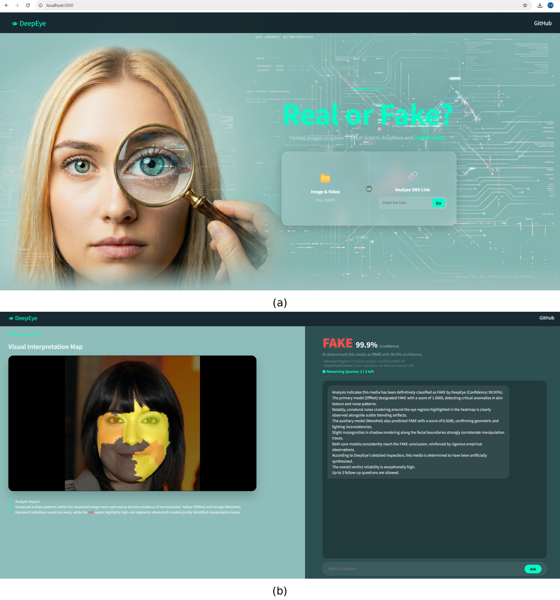
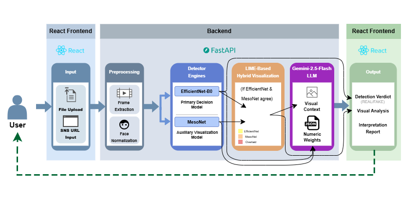
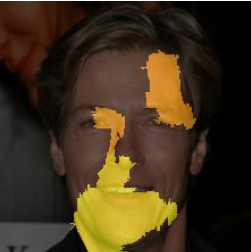
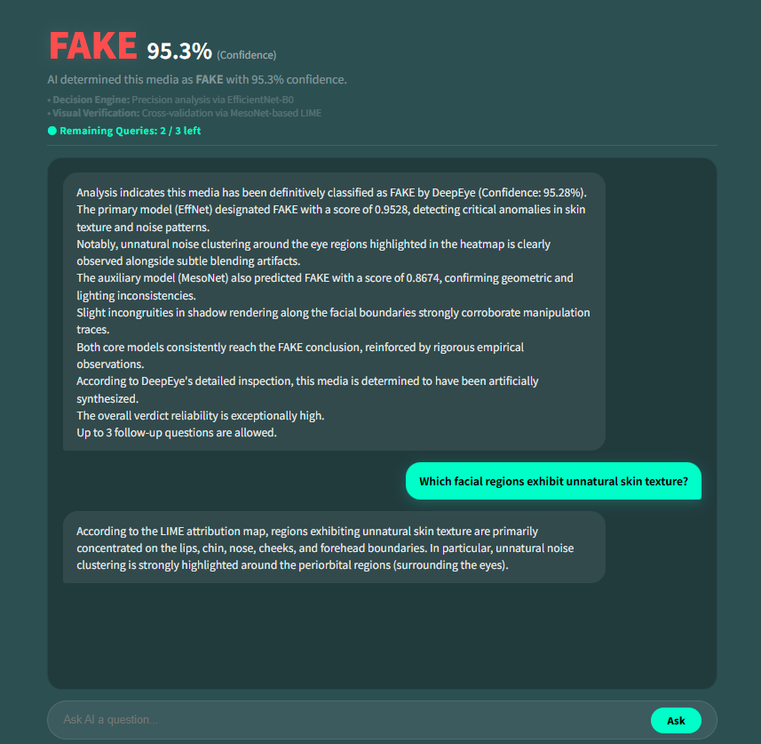

# DeepEye: A Human-Centric Deepfake Detection Framework with Hybrid Visual Explanations and Large Language Models

<p align="center">
  
</p>

<p align="center">
  <a href="https://doi.org/10.1109/ACCESS.2017.DOI"></a>
  
  
  
  
  
  
</p>

---

## 📌 1. Overview

**DeepEye** is an explainable, human-centric deepfake inspection framework developed to bridge the critical interpretive gap between complex black-box detection models and end users. Traditional deep learning detectors output only scalar probability scores or broad heatmaps that offer little forensic rationale for non-experts.

DeepEye tackles this challenge by decoupling detection from visual interpretation across a complementary pipeline:
- **Dual-Model Forensic Architecture**: Combines **EfficientNet-B0** as a primary classification detector (global semantics & fine facial textures) with an ultra-compact **MesoNet** (0.28M parameters) as an auxiliary detector (mesoscopic noise and boundary inconsistencies).
- **Consensus-Aware Superpixel Attribution**: Implements a **LIME-based hybrid visual explanation** scheme that distinguishes model-specific evidence from cross-model consensus regions (highlighted in red).
- **Evidence-Conditioned Natural Language Diagnostics**: Translates multi-model predictions and serialized spatial XAI metrics via **Gemini 2.5 Flash** into structured natural-language reports and multi-turn interactive Q&A.
- **End-to-End Practical Web Deployment**: Supports both local media uploads and direct social media URL stream processing (YouTube, Instagram) via a FastAPI and React architecture.

---

## 🏗️ 2. System Architecture

The DeepEye pipeline processes candidate media across four functional tiers:

<p align="center">
  
</p>

1. **Ingestion & Preprocessing Tier**: Accepts local media files or social media streaming URLs (ingested via `yt-dlp`). Candidate frames are sampled and faces are detected/cropped using **MTCNN**, normalized to required tensor dimensions ($224\times224$ for EfficientNet, $256\times256$ for MesoNet).
2. **Dual-Model Detection Tier**: Preprocessed face crops are evaluated concurrently by **EfficientNet-B0** (primary verdict) and **MesoNet** (auxiliary mesoscopic verification).
3. **Hybrid LIME Visualization Tier**: Computes superpixel-level attributions. If both models agree on the verdict (e.g., both classify as "Fake"), their attribution maps are merged into a multi-layered color-coded heatmap.
4. **Evidence-Conditioned Interpretation Tier**: Structured numerical weights and the visual attribution image are injected into **Gemini 2.5 Flash**. The LLM generates human-readable forensic rationales and manages interactive Q&A sessions (up to 3 follow-up turns).

---

## ✨ 3. Key Features & Visual Explanations

### Hybrid LIME Visual Attribution
<p align="center">
  
</p>

To eliminate single-model bias, DeepEye visually differentiates attribution layers:
- 🟡 **Yellow Regions (Primary)**: Key superpixels identified by EfficientNet-B0 (semantic distortion, unnatural facial blending).
- 🟠 **Orange Regions (Auxiliary)**: Key superpixels identified by MesoNet (mesoscopic noise and lighting discrepancies).
- 🔴 **Red Regions (Cross-Model Agreement)**: Overlapping superpixels corroborated by both networks, providing high-confidence forensic evidence.

> *Note:* When classifications diverge, the interface defaults solely to EfficientNet-B0 attribution to avoid user confusion.

### Evidence-Conditioned Interpretation & Interactive Q&A
<p align="center">
  
</p>

* **Grounded LLM Reasoning**: The language model acts strictly as an interpreter rather than an unguided classifier. Serialized XAI metrics prevent hallucinations.
* **Conversational Inspection**: Users can inspect specific highlighted zones (e.g., *"Which facial regions exhibit unnatural skin texture?"*) within a stateful session.

---

## 📊 4. Experimental Evaluation

Evaluated on 64,948 test frames from **FaceForensics++ (FF++)**, **Celeb-DF**, and **DFDC** partitioned at the source-video level to prevent data leakage:

### Model Classification Performance vs. Complexity
| Model | Accuracy (%) | Precision (%) | Recall (%) | F1-Score (%) | Parameters | Role in DeepEye |
| :--- | :---: | :---: | :---: | :---: | :---: | :---: |
| **ResNeXt-50** | 96.48% | 95.12% | 98.54% | 96.80% | 22.98M | Benchmark Baseline |
| **Xception** | 96.14% | 95.32% | 97.66% | 96.47% | 20.81M | Benchmark Baseline |
| **EfficientNet-B0** | **95.66%** | **94.25%** | **97.94%** | **96.06%** | **4.01M** | **Primary Detector** |
| **MesoNet** | 83.19% | 80.92% | 90.16% | 85.29% | **0.28M** | **Auxiliary Explainer** |

> **Design Choice**: EfficientNet-B0 achieves competitive accuracy and high recall (97.94%) with more than $5\times$ fewer parameters than ResNeXt-50/Xception. MesoNet requires only 0.28M parameters, providing complementary mesoscopic baselines without computational bottlenecks.

### XAI Faithfulness Evaluation (200 Stratified Test Samples)
| Method | Backbone | Insertion Score (Ins ↑) | Deletion Score (Del ↓) | Confidence Drop (C.D. ↑) |
| :--- | :--- | :---: | :---: | :---: |
| Grad-CAM | EfficientNet-B0 | 0.5085 | 0.7457 | 0.0289 |
| RISE | ResNeXt-50 | 0.5078 | 0.5275 | 0.4301 |
| **LIME (Ours)** | **MesoNet** | **0.7761** | **0.5489** | **0.3820** |
| **LIME (Ours)** | **EfficientNet-B0**| 0.5202 | 0.8611 | 0.4771 |

> **Key Finding**: MesoNet combined with LIME achieved the highest Insertion Score (0.7761), confirming that its selected superpixel boundaries contain decisive manipulation cues.

---

## ⚡ 5. Practical Latency Profiling

Tested on an **NVIDIA GeForce RTX 4060 Ti GPU (16GB VRAM)**:

| Pipeline Stage | Social Media URL Mode | Local Upload Mode | Description |
| :--- | :---: | :---: | :--- |
| **1. Ingestion & Preproc.** | 2.43 s | 0.04 s | Stream access (`yt-dlp`), frame extraction, MTCNN |
| **2. Inference & Visual.** | 6.04 s | 21.44 s | EfficientNet-B0, MesoNet, LIME superpixels |
| **3. Report Generation** | 11.07 s | 10.75 s | Gemini 2.5 Flash API structured reasoning |
| **Total Pipeline Latency** | **19.54 s** | **32.23 s** | End-to-end turnaround time |

---

## 🚀 6. Getting Started

### Prerequisites
- Python 3.10+
- Node.js (v18+) & npm
- NVIDIA GPU with CUDA support
- Google Gemini API Key

### 1. Clone the Repository
```bash
git clone https://github.com/dylim-326/DeepEye.git
cd DeepEye
```

### 2. Backend Setup (FastAPI)
```bash
cd backend
python -m venv venv

# Windows
.\venv\Scripts\activate
# Linux / macOS
# source venv/bin/activate

pip install -r requirements.txt

# Create .env file and add your credentials
cp .env.example .env
```
Edit `.env` to include your Google Gemini API key:
```env
GEMINI_API_KEY=your_gemini_api_key_here
PORT=8000
```

Start the backend server:
```bash
uvicorn main:app --reload --host 0.0.0.0 --port 8000
```

### 3. Frontend Setup (React)
Open a new terminal window:
```bash
cd frontend
npm install
npm start
```
The application will launch at `http://localhost:3000`.

---

## 📂 7. Project Structure

```text
DeepEye/
├── assets/                  # Architecture schematics, heatmaps, and UI screenshots
│   ├── architecture.png     # Overall pipeline schematic (Fig. 1)
│   ├── hybrid_lime.png      # Layered superpixel attribution (Fig. 2)
│   ├── interactive_qa.png   # Conversational inspection UI (Fig. 3)
│   └── web_demo.png         # Web platform landing & result pages (Fig. 6)
├── backend/
│   ├── app/
│   │   ├── api/             # FastAPI route controllers (upload, URL, Q&A)
│   │   ├── core/            # Config settings, logging, and LLM prompt engineering
│   │   ├── models/          # EfficientNet-B0 and MesoNet neural network classes
│   │   ├── services/        # Face detection (MTCNN), LIME XAI generator, Gemini caller
│   │   └── weights/         # Saved model checkpoints (.pth)
│   ├── requirements.txt
│   └── main.py              # Application entry point
├── frontend/
│   ├── public/
│   ├── src/
│   │   ├── components/      # HeatmapViewer, VerificationCard, QAChatBox
│   │   ├── pages/           # Home (Input) and Analysis Dashboard
│   │   ├── services/        # Axios API client
│   │   └── App.js
│   └── package.json
├── .gitignore
├── LICENSE
└── README.md
```

---

## 📝 Citation

If you find this repository or framework helpful in your research, please cite our paper:

```bibtex
@article{lim2026deepeye,
  title={DeepEye: A Human-Centric Deepfake Detection Framework with Hybrid Visual Explanations and Large Language Models},
  author={Lim, Doyeon and Alawami, Mohsen Ali and Al, Walid Abdullah},
  journal={IEEE Access},
  year={2026},
  publisher={IEEE}
}
```

---

## 📄 License

This project is licensed under the MIT License - see the [LICENSE](LICENSE) file for details.